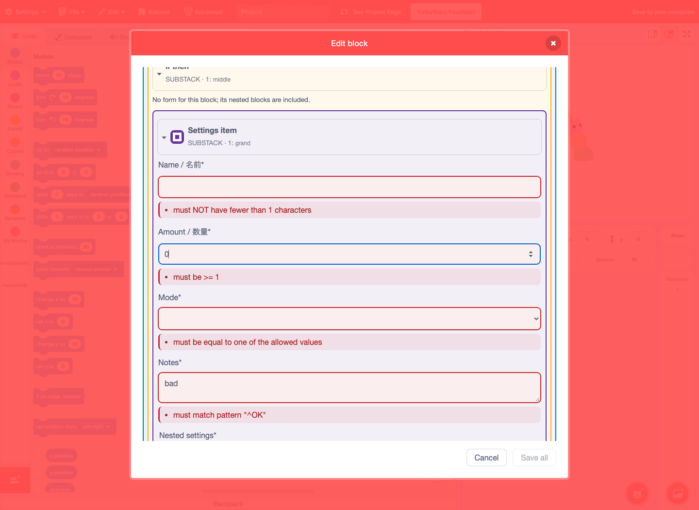
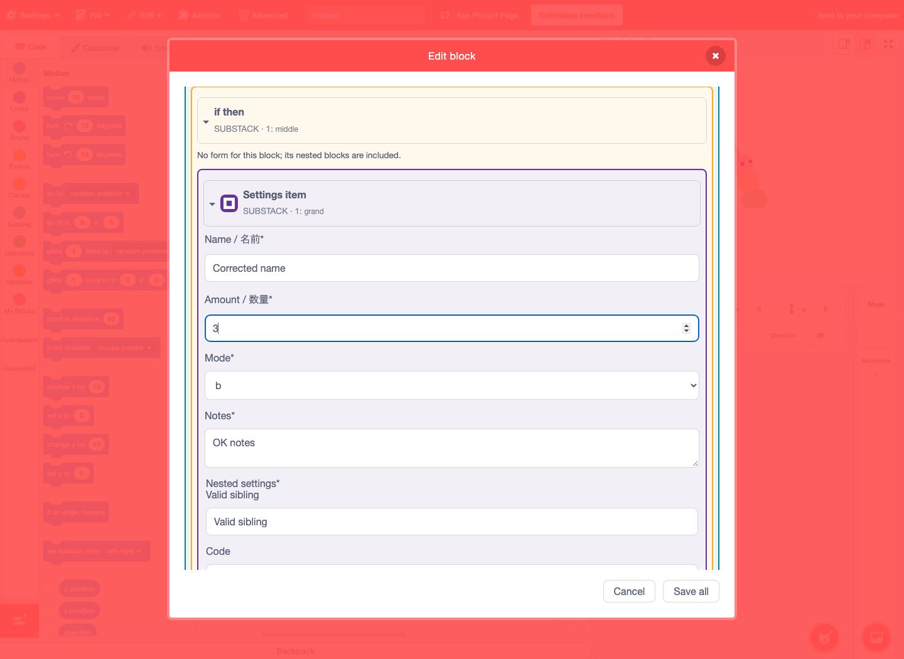
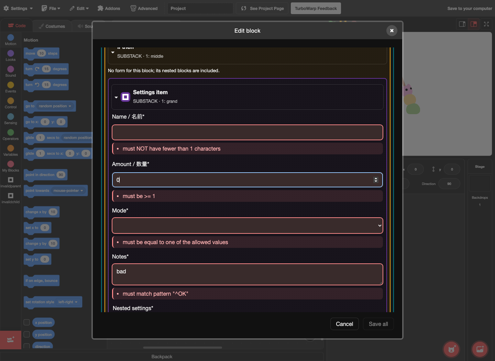
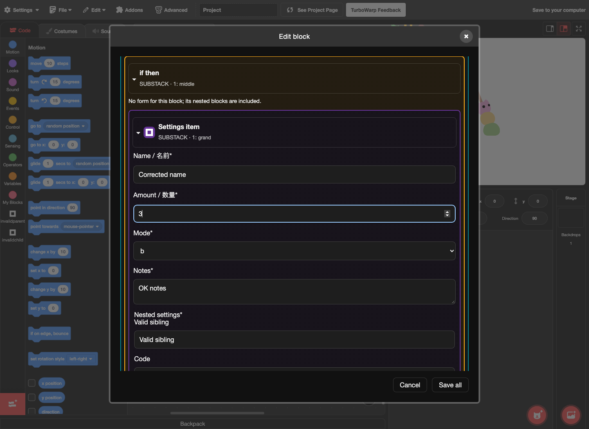

## 公開ページでの明色・暗色の検証（2026-10-18）

[公開エディター](https://kubohiroya.github.io/scratch-gui/editor.html?blockEditorDialogs=1&blockEditorDescendants=1&lang=en)をmacOSのChromiumで実際に操作し、両テーマで以下を確認しました。

- 配信GUIリビジョン: `8515d30e7e7e205103b15c73aee16ba6efa999ce`。共通基盤: `078c178d2987fd46e3cf90d6a61d8c234affc3bc`。公開の`build-info.json`と照合済み。
- 空文字禁止、数値範囲、列挙値、textareaのパターン、入れ子のパターンの5項目に、赤枠・薄い赤背景・既存の説明文を表示。`aria-invalid`と説明への参照も確認。
- 親の青緑（`#087f8c`）、孫の紫（`#663399`）の枠線・薄い背景を維持。ブロック名・アイコンも目視確認。有効な兄弟項目にはエラー表示なし。
- 5項目をvalidな値へ修正すると、赤枠・エラー背景・説明文・invalid属性が解除され、Save allが有効に戻る。修正前後でブロックの背景・枠線と有効な兄弟項目の表示は変化なし。
- 入力中にVMの元データは変わらず、最後にキャンセルして元のinvalidデータが維持されることを確認。

| テーマ | invalid時の枠線 | valid修正後の枠線 | 修正後のエラー背景・説明 |
| --- | --- | --- | --- |
| 明色 | `rgb(198, 40, 40)` | `rgba(0, 0, 0, 0.15)` | 解除 |
| 暗色 | `rgb(255, 138, 138)` | `rgba(255, 255, 255, 0.15)` | 解除 |

検証用の拡張・データはブラウザ内だけに一時ロードしています。Firefox・Safari・他OSは今回の検証対象に含みません。Issueは完了のまま維持します。

## スクリーンショット

### 明色：修正前

### 明色：修正後

### 暗色：修正前

### 暗色：修正後

[実測記録](verification.json)
